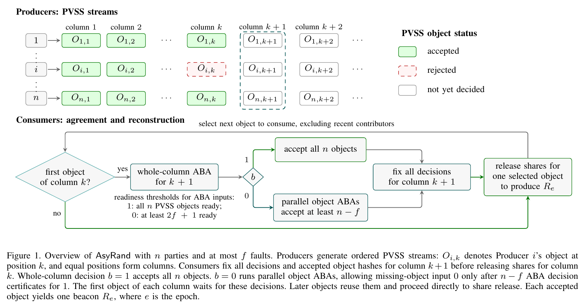

# AsyRand: An Asynchronous Randomness Beacon via Look-Ahead Agreement

This repository contains the Go implementation of AsyRand, along with SPURT
and GRandLine implementations for comparative benchmarks.

## Paper

**AsyRand: An Asynchronous Randomness Beacon via Look-Ahead Agreement**

Liang Zhang, Binyang Hou, Zhengxuan Guo, Haibin Kan, Jiheng Zhang, and Moti Yung.

Cryptology ePrint Archive, Paper 2025/406: [paper page](https://eprint.iacr.org/2025/406)
| [PDF](https://eprint.iacr.org/2025/406.pdf).

## Overview

AsyRand is a publicly verifiable randomness beacon for asynchronous networks
with `n > 3f` parties, where at most `f` parties are Byzantine. It combines
publicly verifiable secret sharing (PVSS) with local-coin asynchronous binary
agreement (ABA), without requiring an external common-coin service or a
distributed key generation setup.

- **Parallel production and consumption.** Each party reliably broadcasts an
  ordered stream of PVSS objects containing hidden random contributions.
  Objects at the same stream position form a column. Producers prepare future
  columns while consumers reconstruct one accepted object per beacon output.
- **Look-ahead agreement.** Consumers agree on the next column's accepted
  objects before revealing contributions from the current column. A
  whole-column ABA can accept all objects at once; otherwise, parallel
  per-object ABAs ensure at least `n-f` accepted contributions. These decisions
  are reused across the column's outputs, amortizing coordination costs.
- **Contributor diversity and chaining.** Selection excludes recent
  contributors, ensuring an honest contribution in every `f+1` consecutive
  outputs. Together with PVSS secrecy, look-ahead agreement, and beacon
  chaining, this provides unpredictability and bias resistance for fixed
  targets at least `f+1` epochs ahead.

With a production window of at least two columns, every fixed epoch completes
with probability one under the paper's assumptions. Optimistic communication
is `O(n²)` per output. The implementation uses ALBATROSS PVSS and WaterBear
Quadratic-ABA.



*Figure 1 from the paper: producers prepare PVSS columns while consumers
agree on the successor column before reconstructing current contributions.*

## Layout

- `spurt/`, `grandline/`, `asyrand/`: protocol implementations and command-line programs.
- `utils/`: shared transport, pairing and cryptographic execution helpers.
- `benchmark/`: native AWS orchestration, compact result collection and Docker comparison tools.
- `asyrand/benchmarks/`: standalone AsyRand optimization measurements.

## Tests

Each Go module can be tested from the repository root:

```sh
go -C utils test ./...
go -C spurt test ./...
go -C grandline test ./...
go -C asyrand test ./...
```

## Benchmarks

See [benchmark/README.md](benchmark/README.md) for dependencies, native AWS
campaigns, measurement boundaries and Docker comparisons.

The latest no-fault campaign compares all three protocols at
n=16,31,61,91,121, with three runs per point. Each run produces 600 outputs,
uses the first 200 as warmup and measures the shared completion-200 to
completion-600 CPU/Tx/wall-time window over 400 outputs.

Results are under `benchmark/runs/aws-repeat23-20261028-600/`:
`results.csv` contains 45 individual run rows, `per-node.csv` contains 2880 node
rows, and `mean.csv` contains 15 three-run means. The `combined` PNG/PDF/SVG
figure presents throughput, application Tx and CPU utilization. `results.zip`
preserves the compact node results, provenance and audits.

The dedicated AWS bastion validates compact results before workers and volumes
are released; local downloads begin only after that release. All task resources
were independently verified as removed after completion. Private keys and AWS
credentials stay local and are excluded from result packages.

Completed campaigns preserve their own frozen sources and audit receipts.
The original Tyche/Fabric and reconfiguration experiment entry points have
been retired; the current experiment guide covers the three protocols above.
